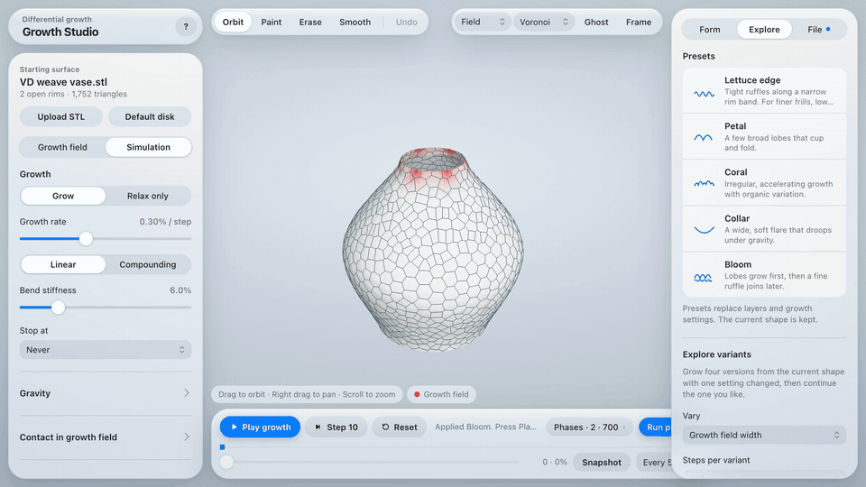

# Growth Studio

Growth Studio is a browser app for differential growth. Start from a flat disk or an open STL such as a Fusion vase base, decide where and when it grows, and watch the rim ruffle and fold. Save editable projects, and export OBJ or STL back to CAD, or as a solid with walls and rounded rims, ready to print.

**Use it online:** https://gil336699.github.io/growth-studio/



The demo is sped up 10 times while the vase grows. [Watch it in HD (MP4)](docs/demo.mp4).

Everything runs in your browser. Models you upload and the shapes you grow stay on your computer.

## Run

Requirements: Node.js 22 or newer and a current desktop browser with WebGL.

```bash
npm install
npm run dev
```

Open the address Vite prints, normally `http://localhost:5173`.

To build static files you can host anywhere, run `npm run build`. The site is written to `dist/`. Preview it with `npm run preview`.

## Publish

Each push to `main` builds the app and publishes it to GitHub Pages through `.github/workflows/pages.yml`. The site is live about a minute later. The build uses relative paths, so `dist/` also works on any other static host, in a subfolder, or on a custom domain.

## Layout

The 3D view fills the window, and the controls float above it on translucent glass, in the style of Apple's Liquid Glass. The look follows the system's light or dark appearance, and its Reduce transparency and Increase contrast settings.

- **Top left.** The app name and the **?** button for shortcuts and the quick start.
- **Left panel.** The starting surface, with Upload STL, Default disk, and any warnings about the mesh. Below it, the **Growth field** tab holds the growth layers and the **Simulation** tab holds growth rate, stopping, gravity, contact, and advanced settings.
- **Top of the 3D view.** Tools (Orbit, Paint, Erase, Smooth, Undo) on the left. Choosing a brush tool shows its size, strength, hardness, and symmetry just below. Color overlay, mesh view, ghost, and framing on the right.
- **Bottom of the 3D view.** The timeline dock: **Play growth**, **Step**, and **Reset**, the status, scrubbing, snapshots, and phases.
- **Right panel.** **Form** shows measurements, Fold size, and stats. **Explore** has presets and variants. **File** saves, opens, and exports, and shows a dot when there are unsaved changes.

On tablets the 3D view sits on top, with both panels below it. On phones everything is in one column.

## Help in the app

- **Hover any control**, or move to it with Tab, to see a short description of what it does, with its keyboard shortcut. Buttons that are unavailable say why, for example why Play is off.
- **Terms with a dotted underline**, such as Target strain, explain themselves on hover.
- **Quick start** shows three steps on the first visit. Reopen it from the **?** button.

## Workflow

1. **Starting surface.** Use the default disk, or choose **Upload STL**. Open rims are detected automatically.
2. **Growth layers.** Decide where growth comes from. Each layer has a strength, its own settings, and optional timing.
3. **Brush.** Pick Paint, Erase, or Smooth above the 3D view and brush growth onto the model, even while it grows.
4. **Grow.** Press **Play growth** in the timeline dock, step in batches, or run a recipe of phases. **Relax only** lets the form settle without adding growth.
5. **Look back.** Scrub the timeline to any snapshot and continue from there.
6. **Save and export.** **Save project** writes an editable `.growthstudio.json` file. **Export OBJ** or **Export STL** writes the current surface in the STL's original coordinates, unless **Center exported mesh** is checked.
7. **Make it printable.** The surface is an open sheet. Turn on **Add thickness** under **File › Export mesh** to export a solid instead (see [Thickness for printing](#thickness-for-printing)).

The app asks before Reset, Upload STL, Default disk, or Open project would discard unsaved work. Growth Lab disk projects also open.

## Growth layers

Where layers overlap, the strongest one wins. Erase and noise apply on top.

| Layer | What it does |
| --- | --- |
| Rim | Grows inward from an open rim (or all rims) over a set width. Lobes grow from evenly spaced spots around the rim instead. |
| Painted | Growth painted with the brush. Erase removes paint first, then masks other layers. |
| Point | A growing spot you place on the model, with a radius. |
| Line | A band of growth along a line you draw on the model. |
| Height ramp | Growth that increases from one height of the starting shape to another. |
| Noise | Organic variation applied to the other layers, with a pattern size and seed. |

Every layer can start and stop at timeline steps, and intensity keyframes ramp it up or down over time.

## Thickness for printing

**Add thickness** gives the sheet a wall and closes every open rim, so Export writes a watertight solid that slicers accept. Growth always runs on the thin sheet; thickness is applied to the view and to the export only, and is saved with the project.

| Setting | Effect |
| --- | --- |
| Wall thickness | The total wall, 0.2 to 5 mm. Most filament printers need at least 0.8 mm, and resin printers about 0.5 mm. |
| Wall side | **Both** centers the wall on the surface. **Outside** puts all of it outside, so the grown surface becomes the inner face; **Inside** puts all of it inside, so the outer size doesn't change. On the default disk these are **Top** and **Bottom**. |
| Rim edge | **Round** closes each rim with a half-round edge, like a leaf or petal. **Soft** is a flat edge with rounded corners, and **Square** cuts straight across the wall. |
| Longest side | The default disk has no units, so its solid, wall and rims included, is scaled to this length in millimeters. An uploaded STL keeps its own millimeters. |
| Show in 3D view | Shows the solid while growth is paused. |

Every fold of the grown surface is kept: the wall is offset along the surface, not rebuilt. Where folds come closer together, or bend more tightly, than the wall is thick, the wall passes through itself. The app checks for this after each change and colors those places pink. It also checks that the solid is closed, and says so if the STL pinches to a point or has faces turned inconsistently. Most slicers merge them; for a clean solid, use a thinner wall, or grow with a larger **Repel distance** so folds stay further apart. A surface with no open rims is already closed and exports as it is.

## Controls

| Control | Effect |
| --- | --- |
| Growth field width | How far a rim layer reaches in. Narrower fields give smaller, more numerous folds. |
| Brush size, strength, hardness | Brush radius, how much a pass adds, and how evenly it paints. A pen's pressure scales strength. |
| Symmetry | Mirror strokes across the vertical axis, or repeat them radially. |
| Growth rate and curve | Expansion per step. **Linear** adds the same amount each step; **Compounding** adds a share of the current size. |
| Bend stiffness | Resistance to tight folds. |
| Stop at | Stops playback at a size, target strain, or step. |
| Fold size (Form) | Sets rim width and bend stiffness together, from fine to broad. |
| Gravity | Pulls on the growth field only. The rest of the model stays in place. |
| Repel distance and strength | How far apart folds in the growth field stay when they meet, and how quickly they are pushed back. |
| Remesh edge length, Mesh detail limit (Simulation › Advanced) | Starting triangle size and how many vertices growth can add. |

The **Form** tab reports waves on each growing rim, size compared with the start, and dimensions in millimeters. The **Color** menu above the 3D view switches the overlay between the growth field, growth so far, and recent contact, and **Ghost** shows the starting shape.

In the **Explore** tab, **Presets** set layers and settings for common forms: lettuce edge, petal, coral, collar, and bloom. **Explore variants** grows four versions from the current shape with one setting changed, so you can continue the one you like.

## Keyboard shortcuts

| Key | Action |
| --- | --- |
| Space | Play or stop |
| . | Step |
| O, B, E, S | Orbit, paint, erase, smooth |
| [ and ] | Brush size |
| ⌘Z or Ctrl+Z | Undo brush stroke |
| G | Next color overlay |
| F | Frame the model |
| 1 to 4 | Mesh view |
| ⌘S or Ctrl+S | Save project |
| Esc | Back to orbit |
| ? | Show shortcuts |

## How the simulation works

Each edge in the growth field has a target length that increases as the sheet grows. Stretching and bending constraints move the surface toward those targets, and new triangles are added when edges grow long. Self-contact pushes apart vertices and faces, edges, and folds at sharp creases before they meet. When a step would still pass the surface through itself, the step is undone, the touching parts are separated, and growth slows until steps are accepted again.

This is a position-based design model. It is not a validated thin-shell or biological simulation.

## Known limits

- Each step takes longer as the vertex count rises. On the weave vase the physics takes about 12 ms a step at 1,200 vertices and about 39 ms at 3,500. Growth runs in a background worker, so the view, orbiting, and the controls stay smooth while steps slow down: Chrome draws about 54 frames per second on a closed pot whose steps take about 100 ms. The shape itself updates only as fast as the steps finish.
- Stop takes effect after the step in progress, which on a dense mesh can take a few hundred milliseconds. The status reads Stopping… until then.
- Opening a very large STL still pauses the page while the surface is prepared, about 6 seconds for 181,000 triangles.
- Very dense growth, such as compounding beyond about 15 times the original size, blocks more steps and slows to a few steps per second.
- STL files carry no units. Dimensions, and the wall of a thickened STL, are in millimeters.
- The wall has one thickness everywhere; it cannot yet vary across the model.
- Browsers may slow work in hidden tabs, so growth can slow down while the tab is hidden. The view catches up when you return.

## Development

```bash
npm run lint
npm test
npm run build
```

- `src/App.tsx`: the workspace, timeline, and project files
- `src/lib/diskSession.ts`: the page's handle on the model. The model moves into `src/physics/simulation.worker.ts` on the first Play, and the page keeps a mirror for the view
- `src/components/`: the viewport, layers, timeline, and variant panels
- `src/physics/`: the growing surface, growth layers, contact, bending, remeshing, and Voronoi views
- `src/lib/`: STL import, project files, export, thickness for printing (`thicken.ts`), presets, readouts, and symmetry

Growth Studio was split out of Growth Lab at commit `2837c65`.

## License

Growth Studio is released under the [MIT License](LICENSE).
